# Cuidar.me — App Mobile

Aplicativo mobile (React Native + Expo) para a gestão do consultório de uma psicóloga: cadastro de pacientes, agenda de consultas, anotações do dia e acesso por login.

O app é **offline first**: tudo é salvo primeiro no próprio aparelho (SQLite) e enviado para a [API Cuidar.me (Spring Boot)](https://github.com/jhenniferknc/cuidarme-springboot) quando há internet. Sem conexão, o app continua funcionando normalmente.

Projeto da disciplina Programação para Dispositivos Móveis 2026.2, do curso de Análise e Desenvolvimento de Sistemas do IFPB — Campus Esperança.

**Equipe:** Jhennifer Kelly Nicolau da Cunha e Joyce Gregório da Silva.

## Mini-mundo

Atualmente, muitos psicólogos enfrentam dificuldades na gestão de suas atividades administrativas, como organização de prontuários e agendamentos de consultas. A falta de um sistema centralizado pode gerar inconsistências nos registros, atrasos em pagamentos e dificuldades na comunicação com os pacientes, comprometendo a eficiência do atendimento e a experiência dos clientes. Além disso, a necessidade de garantir a segurança e o sigilo das informações conforme as diretrizes da LGPD impõe desafios adicionais. Diante desse cenário, o Sistema de Gerenciamento para Psicólogos surge como uma solução integrada para otimizar a administração de consultórios psicológicos. O sistema permite o cadastro de pacientes, gerenciamento de agendamentos, controle de pagamentos, armazenamento seguro de prontuários e geração automatizada de documentos personalizados. Inicialmente projetado para atender uma psicóloga, a plataforma visa melhorar a organização e eficiência dos atendimentos, garantindo mais praticidade para a profissional e seus pacientes.

## Funcionalidades

**Acesso do profissional**
- Cadastro com nome, e-mail e senha (mínimo de 8 caracteres, com letras e números) e login, feitos pela API. É preciso estar conectado à internet para entrar ou se cadastrar
- As abas do app só abrem com o profissional logado. Sem login, o app redireciona para a tela de login. O login fica salvo, então fechar e reabrir o app não pede a senha de novo
- **Sair** apaga os dados do aparelho. Se ainda houver alterações não enviadas ao servidor, o app avisa antes
- Telas de **Sobre** e **Contato**, acessíveis antes do login (no cabeçalho) e depois do login (pelo ícone ⓘ). No Contato, tocar no telefone abre o WhatsApp e tocar no e-mail abre o app de e-mail

**Início**
- **Consultas do dia**, no topo
- **Anotações do dia:** um campo para o resumo do dia ou lembretes rápidos. Salva sozinho enquanto a pessoa digita, e as setas ‹ › navegam pelos dias anteriores. Cada profissional tem uma anotação por dia, guardada só no aparelho

**Pacientes** (aba *Pacientes*) — CRUD completo
- **Cadastrar** com dados pessoais, endereço pessoal, endereço de trabalho e contato de emergência (os dois últimos são opcionais)
- **Listar** com busca por nome ou CPF, e **ver mais** detalhes de cada paciente
- **Editar** (abre o formulário já preenchido) e **excluir**, com confirmação. Excluir um paciente também exclui os agendamentos dele
- Validações: campos obrigatórios, CPF (11 dígitos, sem conferir os dígitos verificadores), telefone, CEP, UF, CPF duplicado, e data de nascimento escolhida em um seletor (não aceita datas futuras)

**Agenda** (aba *Agenda*)
- **Novo agendamento:** busca o paciente, escolhe data, horário e tipo (online ou presencial, com a localidade)
- **Consultas agendadas:** lista com o status de cada consulta e as ações **marcar como concluída**, **remarcar** (muda data, horário e local) e **cancelar**, com confirmação e aviso de sucesso ou erro
- **Filtro por status:** todas, agendadas, remarcadas, concluídas e canceladas

**Sincronização**
- Um aviso no topo das abas mostra quando o app está **sem internet** e quantas alterações **aguardam envio**
- Se o servidor recusar alguma alteração (por exemplo, CPF já cadastrado), ela aparece numa lista de **alterações com erro**, com as opções **tentar de novo** ou **descartar**

## Offline first

As telas nunca falam direto com a API. Elas leem e gravam no SQLite, e um serviço de sincronização cuida da comunicação com o servidor.

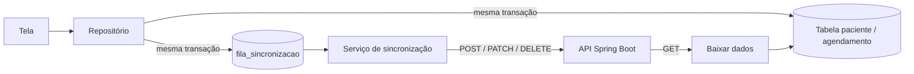

### 1. Gravar no aparelho e na fila
Cada cadastro, edição ou exclusão grava no SQLite **e** coloca um item na tabela `fila_sincronizacao`, **na mesma transação**. Assim, nunca existe um registro salvo sem o item na fila, nem o contrário. O ID de cada paciente e agendamento é um **UUID gerado no próprio app** (`Crypto.randomUUID()`), então o registro já tem o seu ID definitivo mesmo sem internet.

### 2. Enviar a fila
O serviço de sincronização ([`services/sincronizacao.ts`](services/sincronizacao.ts)) envia os itens **em ordem, um por vez**. A ordem importa: o paciente precisa chegar ao servidor antes dos agendamentos dele. Ele é disparado:
- **1 segundo depois** de qualquer alteração (se houver internet, o envio é quase imediato)
- ao **abrir o app** e quando o app **volta do segundo plano**
- quando a **conexão volta** (`@react-native-community/netinfo`)
- a cada **30 segundos**, enquanto houver itens pendentes

O que acontece com cada resposta do servidor:

| Resposta | O que o app faz |
|---|---|
| **2xx** (sucesso) | Remove o item da fila e segue para o próximo |
| **Sem resposta** (sem internet ou tempo esgotado) ou **5xx** | Guarda o item, soma uma tentativa e **para**. Os próximos também falhariam, então tenta de novo mais tarde |
| **4xx** (por exemplo, 409 de CPF duplicado ou 404) | Marca o item com o erro e **segue para o próximo**. Reenviar não resolveria, então o usuário é avisado |

Reenviar não duplica dados: a API devolve o registro existente quando recebe um cadastro com um ID que ela já conhece, e excluir algo que já não existe não é tratado como erro.

### 3. Baixar os dados do servidor
Depois de esvaziar a fila, o app busca os pacientes e os atendimentos do profissional na API ([`services/baixarDados.ts`](services/baixarDados.ts)) e atualiza o SQLite. Isso traz para o aparelho o que foi alterado em outro lugar e remove o que foi excluído no servidor.

### Regra de conflito: a última gravação vence
- O que **ainda está na fila** (alterado no aparelho e não enviado) **não é sobrescrito** pelo download. A alteração local é preservada até ser enviada
- Quando a alteração é enviada, ela **substitui** a versão do servidor. Ou seja, vale a última alteração que chegou ao servidor
- Fora isso, o servidor é a referência: o que vem do download substitui a cópia local

Essa regra é simples e adequada para o cenário do app (uma profissional usando o próprio celular). Com várias pessoas editando o mesmo paciente ao mesmo tempo, uma alteração poderia sobrescrever a outra sem aviso.

## Tecnologias

| Tecnologia | Uso |
|---|---|
| React Native 0.88 + React 19 | Interface |
| Expo SDK 58 | Plataforma e build |
| TypeScript | Código tipado |
| Expo Router | Navegação baseada em arquivos |
| `expo-sqlite` | Banco de dados local |
| `@react-native-community/netinfo` | Saber quando o aparelho está conectado |
| `expo-crypto` | Geração dos UUIDs no aparelho |
| `expo-secure-store` | Sessão do profissional (armazenamento criptografado do aparelho) |
| `@react-native-community/datetimepicker`, `@react-native-picker/picker` | Seletores de data e de opções |
| `expo-linear-gradient`, `@expo/vector-icons` | Visual |

## Persistência local

Escolhemos o **SQLite** em vez do AsyncStorage porque:

- os dados são **relacionais**: um paciente tem vários agendamentos
- o banco garante a **integridade** por conta própria: chave estrangeira com `ON DELETE CASCADE`, CPF `UNIQUE` e `CHECK` nos valores de status
- **busca, filtro e ordenação** (por nome ou CPF, consultas por data) são consultas SQL, em vez de percorrer listas em memória
- a **fila de sincronização** precisa ser gravada na mesma transação que os dados, o que o SQLite oferece
- o esquema evolui por **migrações versionadas** (`PRAGMA user_version`), então os dados já gravados são preservados quando uma tabela muda

O `expo-secure-store` guarda apenas o **id, o nome e o e-mail** do profissional logado, no armazenamento criptografado do sistema (Keychain no iOS, Keystore no Android). A senha nunca fica no aparelho.

## Modelo de dados

Banco `cuidarme.db`. O esquema está na versão 10 e as migrações ficam em [`database/migrations.ts`](database/migrations.ts).

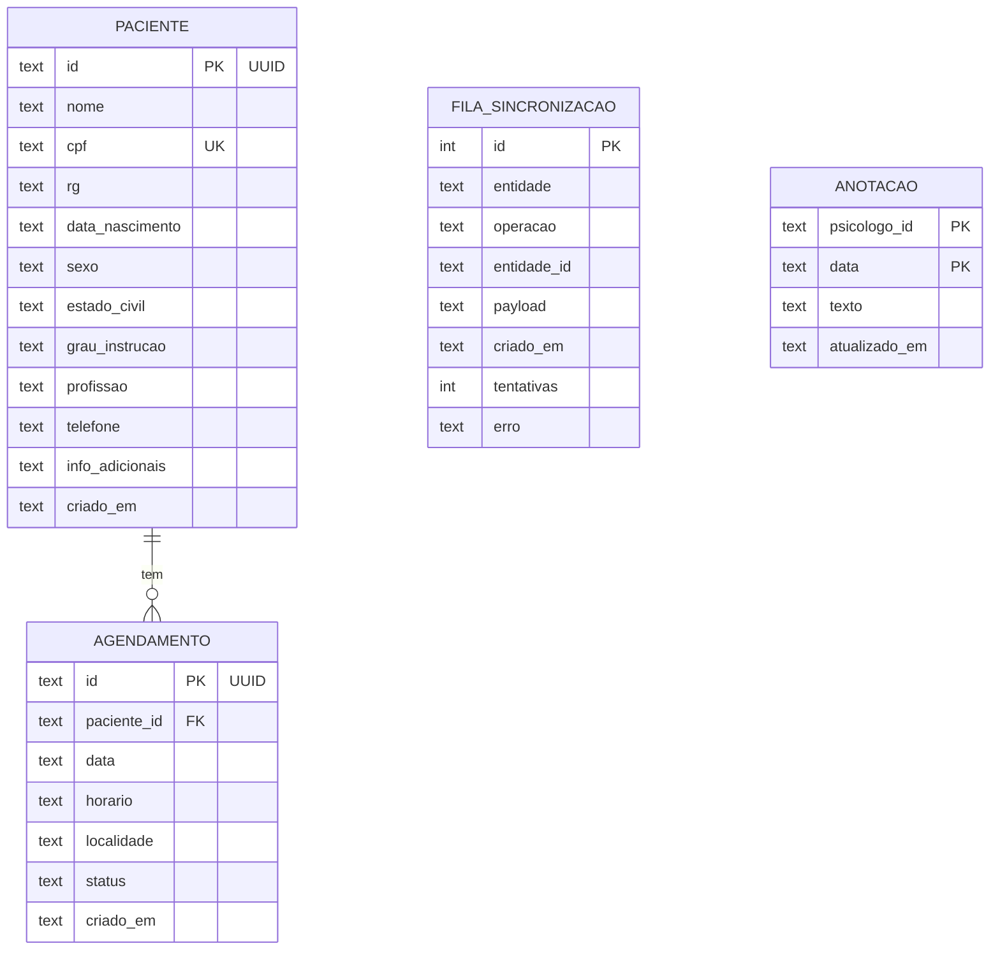

- **paciente:** o endereço pessoal, o de trabalho e o contato de emergência ficam em colunas da própria tabela (por exemplo `cep_pessoal`, `cidade_trabalho`, `nome_contato_emergencia`). Os campos obrigatórios são `NOT NULL`
- **agendamento:** `data` em `AAAA-MM-DD` e `horario` em `HH:mm` (na API, os dois viram um único `2026-11-20T14:30:00`). `status` aceita apenas `AGENDADO`, `CONCLUIDO`, `CANCELADO` ou `REMARCADO`, os mesmos valores da API
- **fila_sincronizacao:** `entidade` (`paciente` ou `atendimento`), `operacao` (`CRIAR`, `ATUALIZAR` ou `EXCLUIR`) e o corpo da requisição em `payload` (JSON). O `id` numérico define a ordem de envio. `erro` fica preenchido quando o servidor recusa o item
- **anotacao:** uma anotação por profissional e por dia. Fica só no aparelho, sem sincronização
- **Migrações:** 1 (paciente), 2 (agendamento), 3 (correção do `CHECK` do status), 4 (psicologo), 5 (coluna `horario`), 6 (IDs em UUID), 7 (fila de sincronização), 8 (anotações), 9 (remove a tabela psicologo, já que o login passou para a API) e 10 (status iguais aos da API)

## Segurança

- A senha é enviada para a API, que a guarda como **hash BCrypt**. Ela nunca é salva no aparelho
- O login responde com a mesma mensagem para e-mail inexistente e para senha errada, para não revelar quais e-mails existem
- O endereço da API fica no `.env.local`, que não vai para o repositório

## Componentes reutilizáveis

Peças genéricas em [`components/ui/`](components/ui/), usadas em várias telas:

| Componente | O que faz | Onde é usado |
|---|---|---|
| `FundoGradiente` | Fundo em gradiente das telas | Início, Pacientes, Agenda, Login, Cadastro e Sobre |
| `AbasSegmentadas` | Abas no topo da tela, a partir de uma lista de abas | Pacientes e Agenda |
| `EstadoVazio` | Ícone e mensagem para listas sem itens | Início, Consultas agendadas e Pacientes cadastrados |
| `AvisoSincronizacao` | Aviso de offline, envios pendentes e alterações com erro | Topo das abas |
| `Header` | Cabeçalho das abas, com o menu ⓘ e o botão Sair | Todas as abas |

As cores do app ficam em [`constants/cores.ts`](constants/cores.ts).

## Estrutura do projeto

```
app/                 Telas e navegação (Expo Router). Tudo aqui vira uma rota.
  (tabs)/            Abas protegidas: Início, Pacientes, Agenda
  loginPage.tsx, cadastroPage.tsx, sobrePage.tsx, contatoPage.tsx
components/          Componentes de interface (paciente/, agendamento/, auth/, ui/)
constants/           Cores do app
contexts/            AuthProvider (quem está logado) e SyncContextProvider (dispara a sincronização)
services/            Cliente HTTP (api), login e cadastro (authService), sessão,
                     fila (sincronizacao) e download dos dados (baixarDados)
database/            Migrações e repositórios (paciente, agendamento, fila, anotação)
types/               Tipos TypeScript do domínio
utils/               Validações e datas
```

A separação segue o fluxo **tela → repositório → banco**, e **fila → serviço de sincronização → API**: as telas não escrevem SQL nem chamam a API, e os repositórios não conhecem a interface.

## Como executar

**Pré-requisitos:** Node.js (versão LTS), a [API Cuidar.me](https://github.com/jhenniferknc/cuidarme-springboot) rodando (veja o README dela) e um emulador Android ou um celular com o app **Expo Go** compatível com a SDK 58.

1. Instale as dependências:
   ```bash
   npm install
   ```
2. Copie o `.env.example` para `.env.local` e informe o endereço da API:
   ```
   EXPO_PUBLIC_API_URL=http://192.168.x.x:8082/cuidarme/api
   ```
   Para testar no celular com a API rodando no computador, use o **IP do computador na rede** (`ipconfig` no Windows, campo "Endereço IPv4" do Wi-Fi), e não `localhost`. Se a API estiver publicada, use o endereço dela.
3. Inicie o app:
   ```bash
   npx expo start --clear
   ```
   - No emulador Android: pressione `a` no terminal
   - No celular: leia o QR code com o Expo Go (o celular e o computador precisam estar na mesma rede)

Na primeira vez, é preciso **Cadastrar** a conta do profissional. A navegação por web (`expo start --web`) não é suportada, porque o `expo-secure-store` não existe nesse ambiente.

**Se o app mostrar "sem conexão" com a API ligada:** confira se o IP do `.env.local` ainda é o do computador (ele muda ao trocar de rede) e reinicie com `npx expo start --clear`. Se o celular não alcançar a porta 8082, libere-a no firewall do Windows.

## Prints do app

Os arquivos ficam em `docs/prints/`.

| Login | Cadastro | Início |
|---|---|---|
| 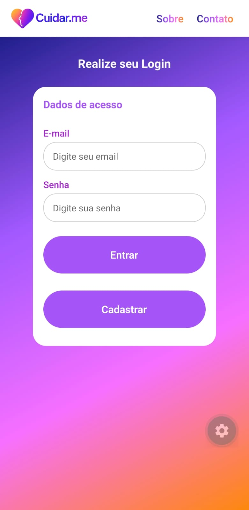 | 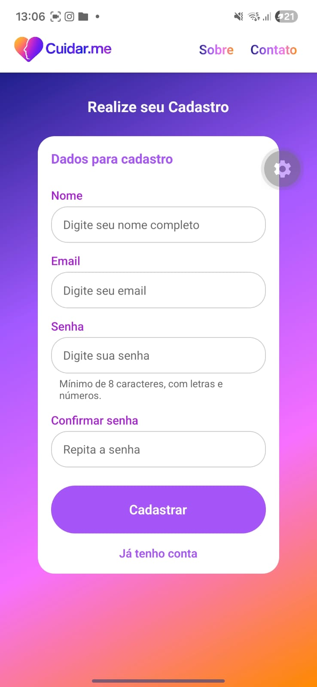 | 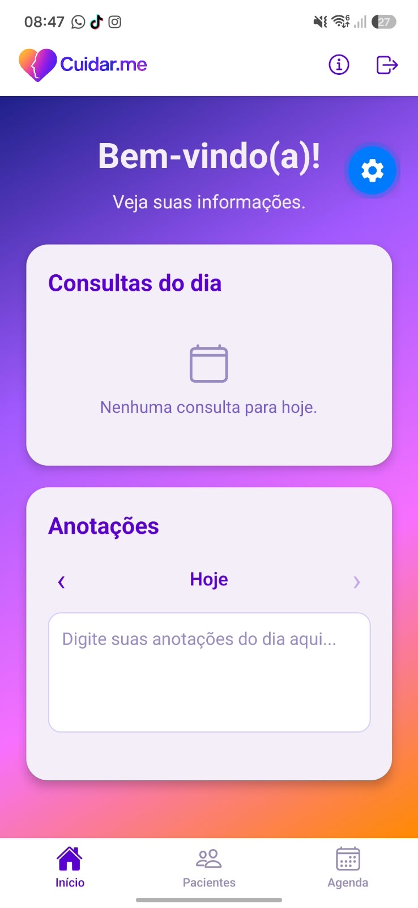 |

| Novo paciente | Pacientes cadastrados | Editar paciente |
|---|---|---|
| 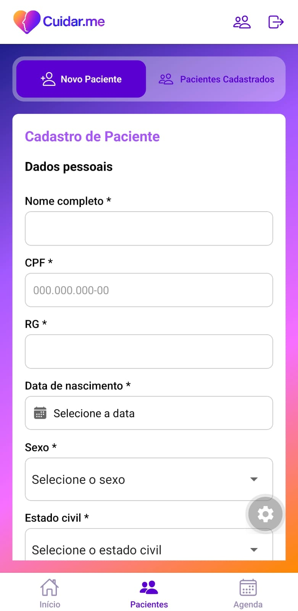 | 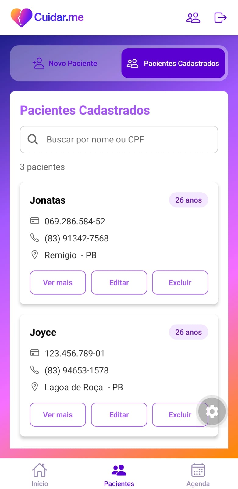 | 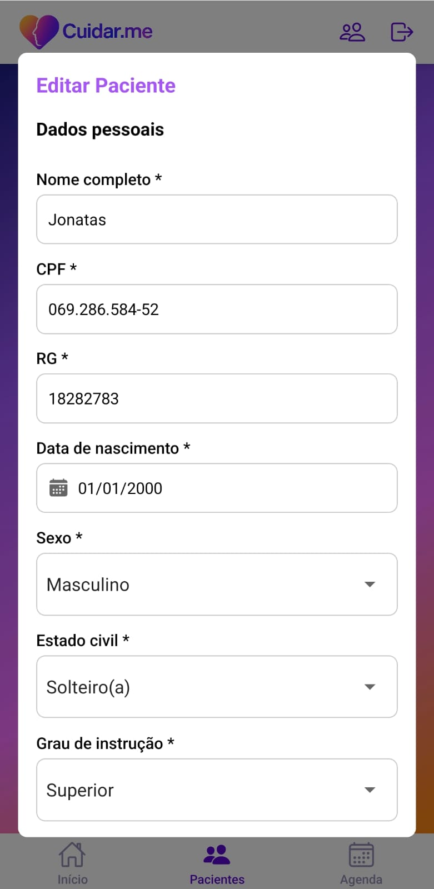 |

| Novo agendamento | Consultas agendadas | Remarcar |
|---|---|---|
| 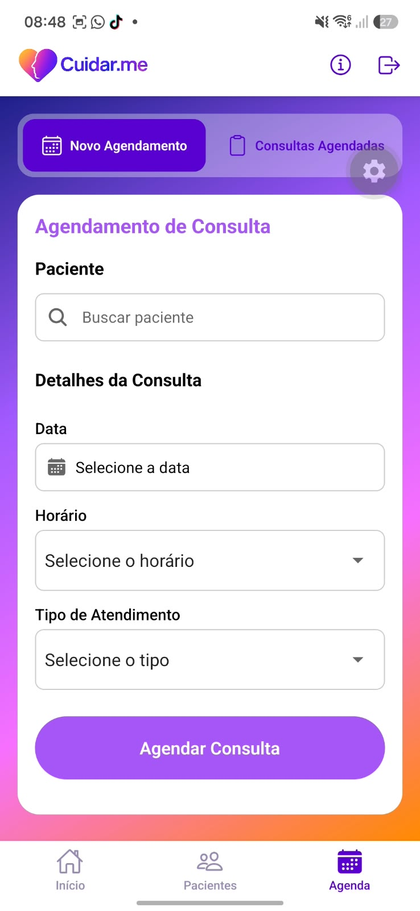 | 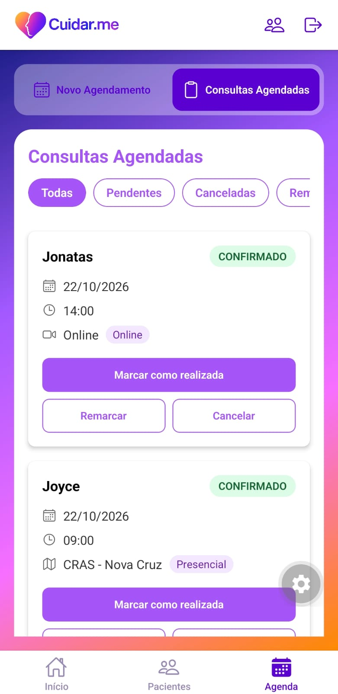 | 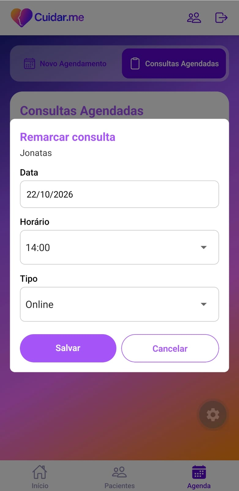 |

## Limitações e próximos passos

- **Login e cadastro exigem internet.** Depois de entrar, o app funciona sem conexão
- **Conflitos:** a regra "a última gravação vence" pode sobrescrever uma alteração sem aviso se o mesmo registro for editado em dois aparelhos ao mesmo tempo
- **As anotações do dia ficam só no aparelho**, sem sincronização, e são guardadas sem criptografia (como o restante do SQLite). Não devem ser usadas para registros clínicos detalhados
- A API já tem **prontuários e pagamentos**, mas o app ainda não tem telas para eles. A geração de documentos e o envio de lembretes também não foram implementados
- Não há recuperação nem troca de senha
- Não há testes automatizados no app (a API tem testes de controller e de service)
- Os botões de ação dos cards de pacientes e de consultas ainda se repetem nos dois arquivos e seriam o próximo candidato a componente reutilizável
