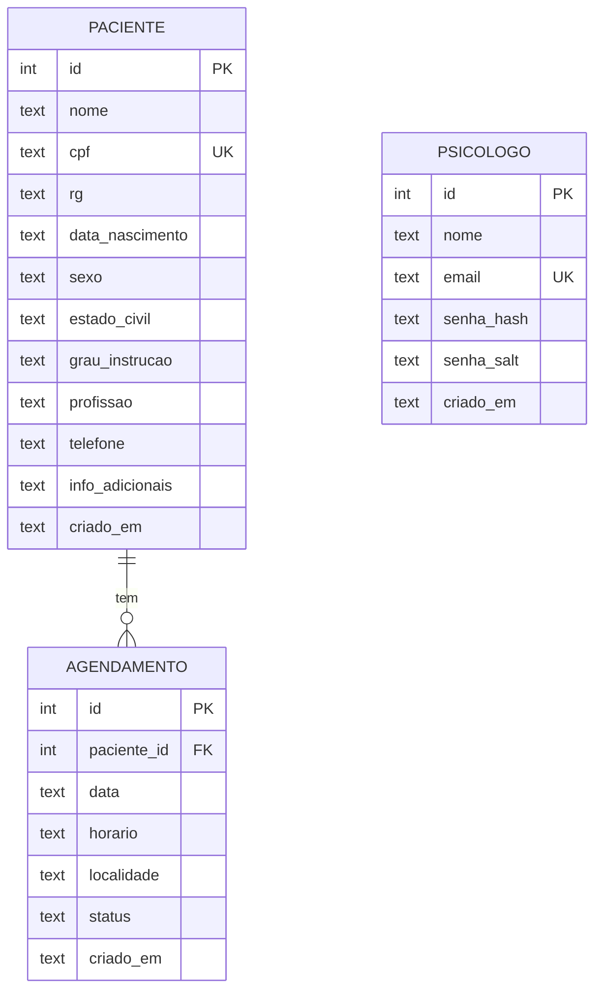
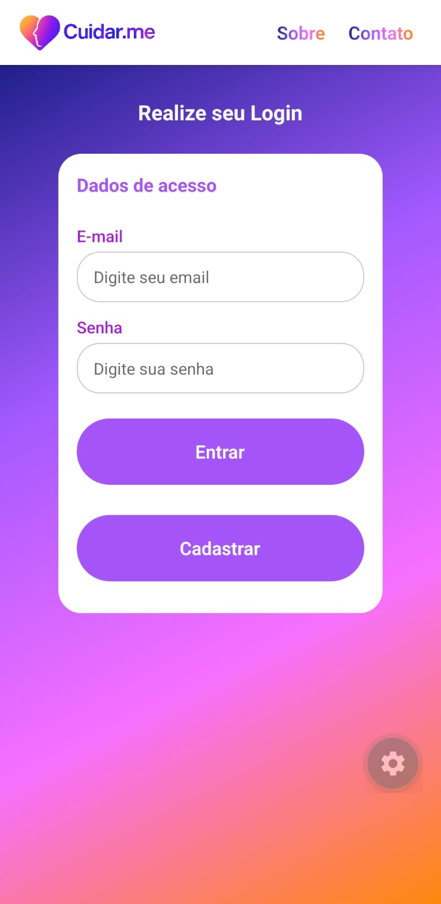
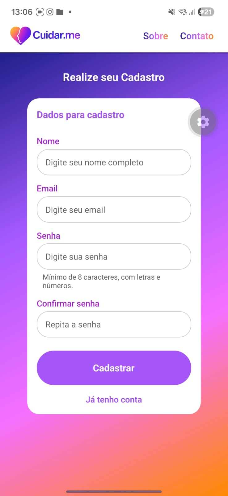
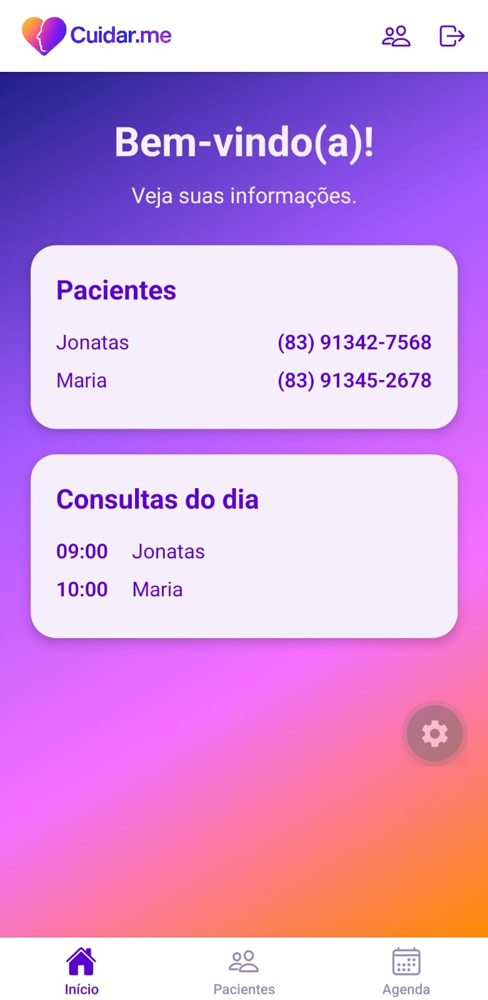
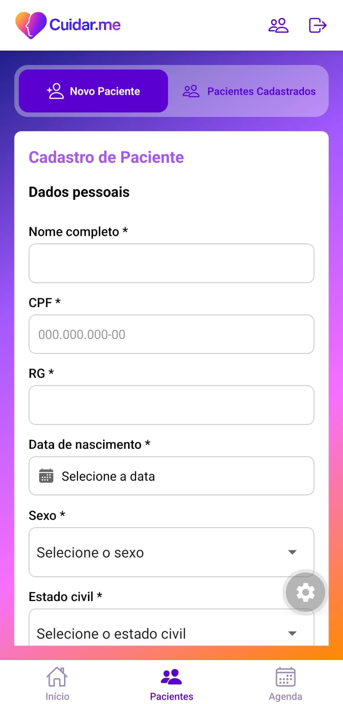
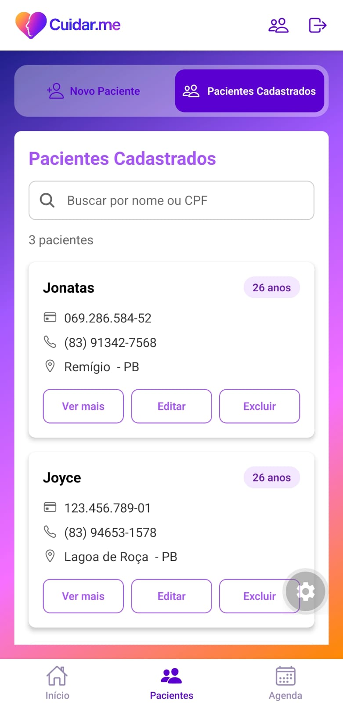
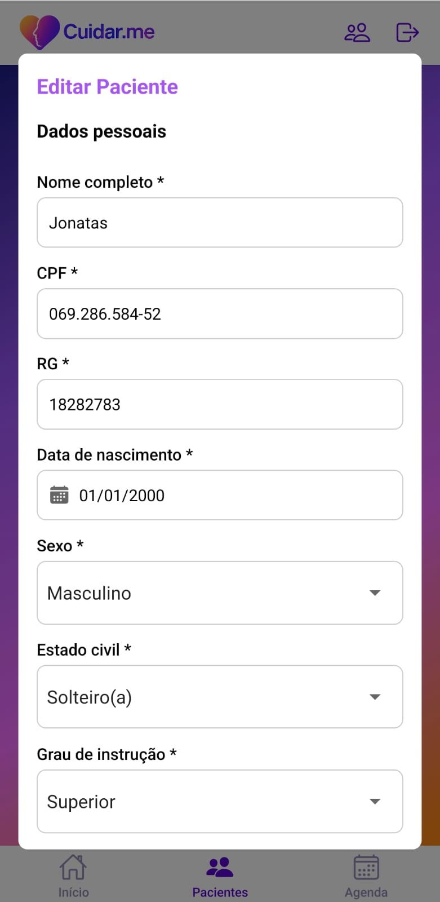
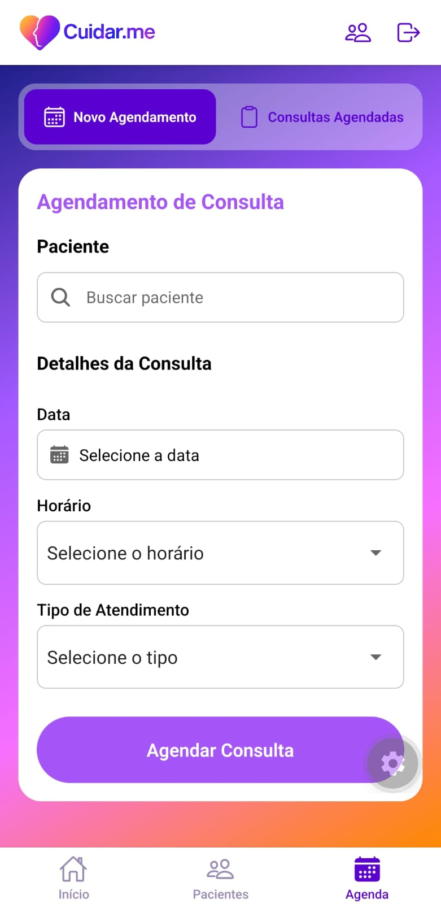
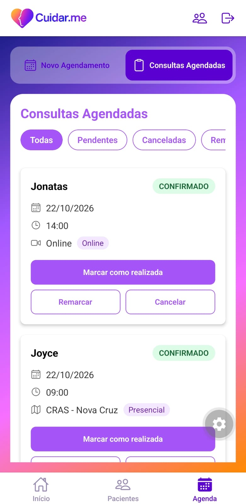
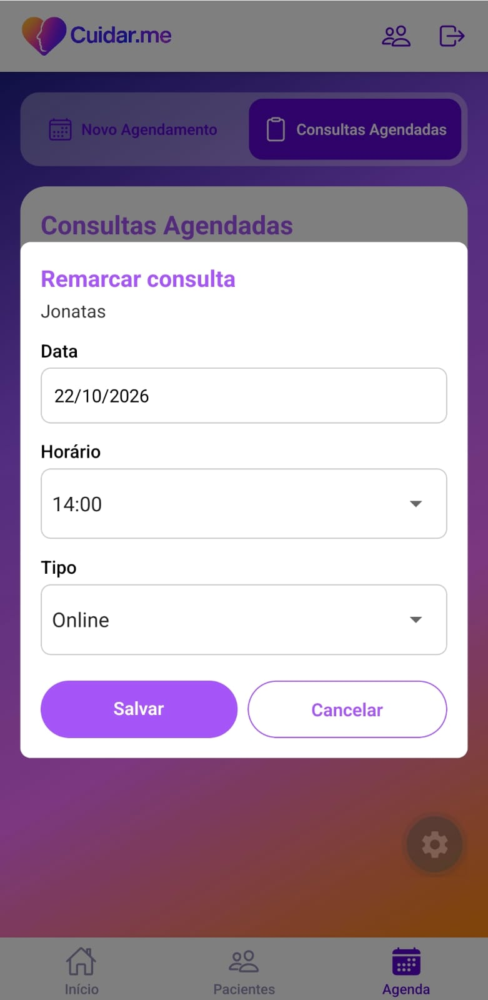

# Cuidar.me — App Mobile

Aplicativo mobile (React Native + Expo) para a gestão do consultório de uma psicóloga: cadastro de pacientes, agenda de consultas e acesso por login. Todos os dados ficam salvos no próprio aparelho (SQLite), sem servidor.

Projeto 1 da disciplina Programação para Dispositivos Móveis 2026.2, do curso de Análise e Desenvolvimento de Sistemas do IFPB — Campus Esperança.

**Equipe:** Jhennifer Kelly Nicolau da Cunha e Joyce Gregório da Silva.

## Mini-mundo

Atualmente, muitos psicólogos enfrentam dificuldades na gestão de suas atividades administrativas, como organização de prontuários e agendamentos de consultas. A falta de um sistema centralizado pode gerar inconsistências nos registros, atrasos em pagamentos e dificuldades na comunicação com os pacientes, comprometendo a eficiência do atendimento e a experiência dos clientes. Além disso, a necessidade de garantir a segurança e o sigilo das informações conforme as diretrizes da LGPD impõe desafios adicionais. Diante desse cenário, o Sistema de Gerenciamento para Psicólogos surge como uma solução integrada para otimizar a administração de consultórios psicológicos. O sistema permite o cadastro de pacientes, gerenciamento de agendamentos, controle de pagamentos, armazenamento seguro de prontuários e geração automatizada de documentos personalizados. Inicialmente projetado para atender uma psicóloga, a plataforma visa melhorar a organização e eficiência dos atendimentos, garantindo mais praticidade para a profissional e seus pacientes.

## Funcionalidades

**Acesso do profissional**
- Cadastro com nome, e-mail e senha (mínimo de 8 caracteres, com letras e números) e login. A senha nunca é guardada em texto puro
- As abas do app só abrem com o profissional logado. sem login, o app redireciona para a tela de login. O login fica salvo, então fechar e reabrir o app não pede a senha de novo. Há também o botão **Sair**
- Telas de **Sobre** e **Contato**, acessíveis antes do login

**Pacientes** (aba *Pacientes*) — CRUD completo
- **Cadastrar** com dados pessoais, endereço pessoal, endereço de trabalho e contato de emergência (os dois últimos são opcionais)
- **Listar** com busca por nome ou CPF
- **Editar** (abre o formulário já preenchido) e **excluir**, com confirmação. Excluir um paciente também exclui os agendamentos dele.
- Validações: campos obrigatórios, CPF (11 dígitos, sem conferir os dígitos verificadores), telefone, CEP, UF, CPF duplicado, e data de nascimento escolhida em um seletor (não aceita datas futuras)

**Agenda** (aba *Agenda*)
- **Novo agendamento:** busca o paciente, escolhe data, horário e tipo (online ou presencial, com a localidade)
- **Consultas agendadas:** lista com o status de cada consulta, **remarcar** (muda data, horário e local) e **cancelar** (muda o status para cancelado), ambos com confirmação ou aviso de sucesso e erro

**Início**

- Boas-vindas e as **consultas do dia**, com paginação.

## Tecnologias

| Tecnologia | Uso |
|---|---|
| React Native 0.86 + React 19 | Interface |
| Expo SDK 57 | Plataforma e build |
| TypeScript | Código tipado |
| Expo Router | Navegação baseada em arquivos |
| `expo-sqlite` | Banco de dados local |
| `expo-crypto` | Salt aleatório e hash SHA-256 da senha |
| `expo-secure-store` | Sessão do profissional (armazenamento criptografado do aparelho) |
| `@react-native-community/datetimepicker`, `@react-native-picker/picker` | Seletores de data e de opções |
| `expo-linear-gradient`, `@expo/vector-icons` | Visual |

## Persistência local

Escolhemos o **SQLite** em vez do AsyncStorage porque:

- os dados são **relacionais**: um paciente tem vários agendamentos
- o banco garante a **integridade** por conta própria: chave estrangeira com `ON DELETE CASCADE`, CPF e e-mail `UNIQUE`, e `CHECK` nos valores de status
- **busca, filtro e ordenação** (por nome ou CPF, consultas por data) são consultas SQL, em vez de percorrer listas em memória
- o esquema evolui por **migrações versionadas** (`PRAGMA user_version`), então os dados já gravados são preservados quando uma tabela muda

O `expo-secure-store` guarda apenas o **id** do profissional logado, no armazenamento criptografado do sistema (Keychain no iOS, Keystore no Android). O banco não guarda sessão

## Modelo de dados

Banco `cuidarme.db`. O esquema está na versão 5 e as migrações ficam em [`database/migrations.ts`](database/migrations.ts).



- **paciente:** o endereço pessoal, de trabalho e o contato de emergência ficam em colunas da própria tabela (por exemplo `cep_pessoal`, `cidade_trabalho`, `nome_contato_emergencia`). Os campos obrigatórios são `NOT NULL`.
- **agendamento:** `data` em `AAAA-MM-DD` e `horario` em `HH:mm`. `status` aceita apenas `PENDENTE`, `CONFIRMADO`, `CANCELADO`, `REALIZADO` ou `REMARCADO`
- **psicologo:** o e-mail é único sem diferenciar maiúsculas de minúsculas. Guarda só o hash e o salt da senha
- **Migrações:** 1 (paciente), 2 (agendamento), 3 (correção do `CHECK` do status), 4 (psicologo) e 5 (coluna `horario`)

## Segurança

- A senha é guardada como **hash SHA-256 com salt aleatório** de 16 bytes, único de cada conta. Duas contas com a mesma senha têm hashes diferentes
- O login responde com a mesma mensagem para e-mail inexistente e para senha errada, para não revelar quais e-mails existem

## Estrutura do projeto

```
app/                 Telas e navegação (Expo Router). Tudo aqui vira uma rota.
  (tabs)/            Abas protegidas: Início, Pacientes, Agenda
  loginPage.tsx, cadastroPage.tsx, sobrePage.tsx, contatoPage.tsx
components/          Componentes de interface (paciente/, agendamento/, auth/, ui/)
contexts/            AuthProvider e hook useAuth (quem está logado)
services/            Regras de cadastro e login (authService) e sessão (sessao)
database/            Migrações e repositórios (paciente, agendamento, psicologo)
types/               Tipos TypeScript do domínio
utils/               Validações, máscaras e hash de senha
```

A separação segue o fluxo **tela → serviço/contexto → repositório → banco**: as telas não escrevem SQL, e os repositórios não conhecem a interface

## Como executar

Pré-requisitos: Node.js (versão LTS) e um emulador Android ou um celular com o app **Expo Go** compatível com a SDK 57

```bash
npm install
npx expo start
```

- No emulador Android: pressione `a` no terminal
- No celular: leia o QR code com o Expo Go (o celular e o computador precisam estar na mesma rede)

O app não vem com usuário de exemplo: na primeira vez, tem que **Cadastrar** e criar a conta do profissional. A navegação por web (`expo start --web`) não é suportada, porque o `expo-secure-store` não existe nesse ambiente

## Prints do app

Os arquivos ficam em `docs/prints/`.

| Login | Cadastro | Início |
|---|---|---|
|  |  |  |

| Novo paciente | Pacientes cadastrados | Editar paciente |
|---|---|---|
|  |  |  |

| Novo agendamento | Consultas agendadas | Remarcar |
|---|---|---|
|  |  |  |

## Limitações/Implementações futuras

- **Os pacientes não são vinculados a um profissional.** O app foi pensado para um(a) único(a) psicólogo(a) por aparelho.Se duas contas forem criadas no mesmo celular, ambas veem os mesmos pacientes.
- Ainda **não foram implementados** os prontuários, o controle de pagamentos, a geração de documentos e o envio de lembretes (o botão "enviar lembrete" da lista de consultas ainda não tem ação)
- Não há recuperação nem troca de senha
- Não há testes automatizados
